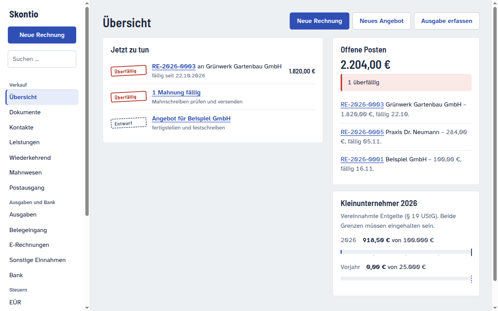
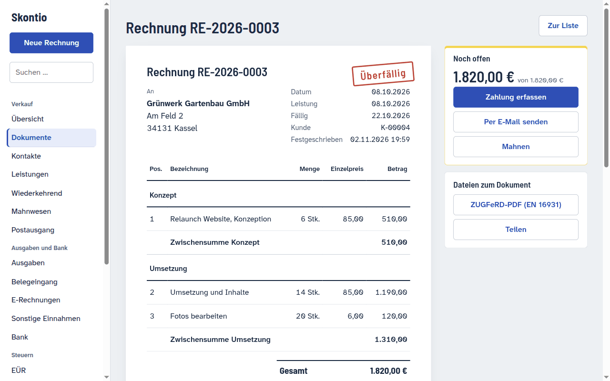
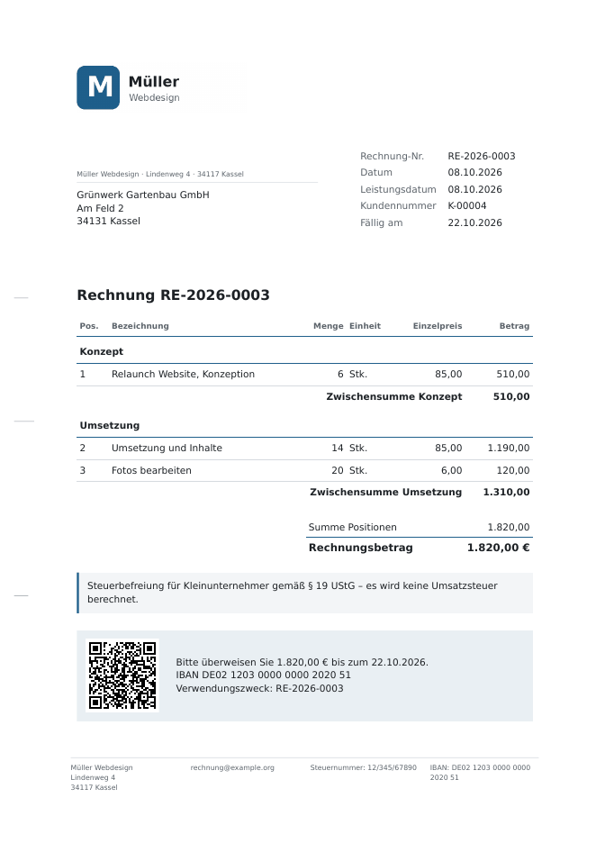
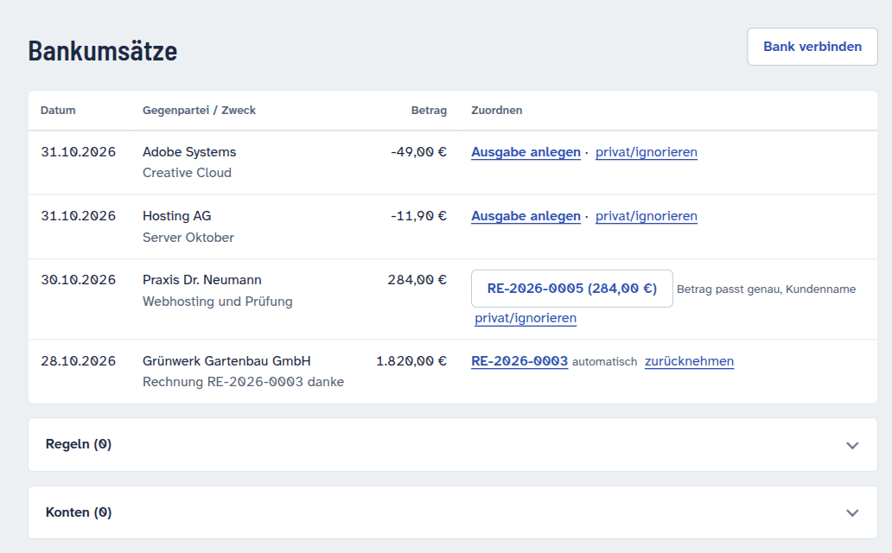
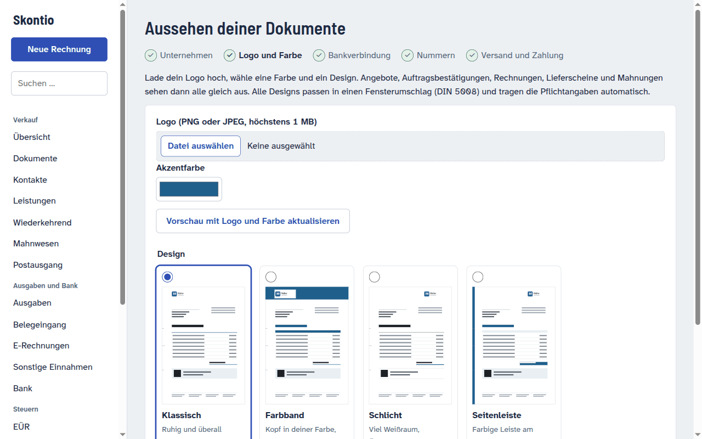

# Skontio

**Rechnungen, Buchhaltung und CRM für Selbstständige in Deutschland – selbst gehostet, E-Rechnung inklusive.**

Skontio schreibt Angebote und Rechnungen nach deutschem Recht, liest E-Rechnungen ein, holt Kontoumsätze ab,
ordnet Zahlungen zu und erstellt EÜR und Umsatzsteuer-Voranmeldung. Es läuft als ein Container auf deinem NAS
oder Server; deine Daten verlassen dein Netz nicht. Alle Funktionen sind frei, ohne Abo und ohne Sperren.

[](https://ko-fi.com/unix0r)
[](LICENSE)

> ⚠️ Skontio ist **keine Steuer- oder Rechtsberatung**. Die Software unterstützt die Einhaltung von GoBD, UStG
> und AO; die Verantwortung bleibt bei dir. Vor dem Echtbetrieb mit der eigenen Steuerberatung abstimmen.



## Funktionen

**Angebote und Rechnungen**
- Angebot → Auftragsbestätigung → Rechnung, Abschlags- und Schlussrechnung, Storno, Lieferschein
- E-Rechnung nach EN 16931: **ZUGFeRD/Factur-X** (PDF/A-3) und **XRechnung**, geprüft mit KoSIT und Mustang
- Kleinunternehmer (§ 19) und Regelbesteuerung mit dokumentiertem Wechsel und Grenzwert-Überwachung;
  § 13b, innergemeinschaftliche Lieferung, Ausfuhr, Arbeitskosten nach § 35a
- Netto- oder Bruttopreise, Positionsgruppen mit Zwischensumme, Rabatte, Deutsch und Englisch
- vier Briefbogen-Designs nach DIN 5008 mit Logo – Pflichtangaben je Rechtsform setzt Skontio selbst
- Versand per E-Mail mit AGB und Datenschutzerklärung als Standardanhang, Mahnwesen, wiederkehrende Rechnungen
- GiroCode und Zahlungslink auf der Rechnung

**Geld und Belege**
- Kontoabruf über PSD2 (Enable Banking) oder Import von CAMT, MT940 und CSV
- automatische Zuordnung eindeutiger Zahlungen – auch Daueraufträge ohne Rechnungsnummer
- Belege per Foto, „Teilen an Skontio“ oder **eigenem Beleg-Postfach**; Belegerkennung mit KI auf Wunsch
- E-Rechnungs-Eingang, Ausgaben, sonstige Einnahmen, wiederkehrende Ausgaben

**Steuern und Auswertungen**
- EÜR, Umsatzsteuer-Voranmeldung (Kennzahlen für Mein ELSTER), Zusammenfassende Meldung
- DATEV-Export (SKR03/SKR04), Gesamtexport als ZIP, frei wählbare Zeiträume

**GoBD und Sicherheit**
- Festschreibung in der Datenbank selbst, lückenlose Nummernkreise, revisionssicheres Archiv
- Änderungsprotokoll als Hash-Kette mit Schlüssel, Anker in jedem Backup; Verfahrensdokumentation auf Knopfdruck
- Login über OIDC (Pocket ID, Authentik, Keycloak) mit Passkeys; Notfall-Login nur aus dem LAN mit 2FA
- gehärteter Container: kein root, keine Shell, schreibgeschützt; signierte Images mit SBOM
- Details: [Container](docs/sicherheit-container.md) · [Angriffsanalyse](docs/sicherheit-angriffe.md)

**KI, wenn du willst**
- KI-Assistent in der App (lokal mit Ollama oder per API) und MCP-Zugang für Claude
- die KI liest und legt **nur Entwürfe** an – festschreiben, versenden und buchen bleibt bei dir

**Bedienung**
- Einrichtungsassistent mit Logo, Design, Bankverbindung und Testmail
- mobil nutzbar, als App installierbar (PWA), hell und dunkel

## Bilder

| | |
|---|---|
|  |  |
| Rechnung mit Positionsgruppen | fertiges PDF mit E-Rechnung im Briefbogen „Klassisch“ |
|  |  |
| Bankumsätze mit Zuordnungsvorschlägen | Design und Logo im Einrichtungsassistenten |

## Skontio im Vergleich

| | Skontio | sevdesk | Lexware Office | Papierkram | Invoice Ninja |
|---|---|---|---|---|---|
| Betrieb | selbst gehostet | Cloud | Cloud | Cloud | selbst gehostet oder Cloud |
| Kosten | frei | Abo, eingeschränkter Gratistarif | Abo, je nach Tarif | Abo, eingeschränkter Gratistarif | selbst gehostet frei, Cloud und White-Label kostenpflichtig |
| Quelltext | offen (AGPL-3.0) | geschlossen | geschlossen | geschlossen | einsehbar (Elastic License 2.0) |
| Deine Daten liegen | bei dir | beim Anbieter | beim Anbieter | beim Anbieter | bei dir oder beim Anbieter |
| E-Rechnung (ZUGFeRD/XRechnung) erzeugen | ja | ja | ja, je nach Tarif | ja | ja |
| Ausrichtung | deutsches Steuerrecht | deutsches Steuerrecht | deutsches Steuerrecht | deutsches Steuerrecht | international |

Stand November 2026 nach Angaben der Hersteller ([sevdesk](https://sevdesk.de/funktionen),
[Lexware Office](https://help.lexware.de/de-form/articles/10199856-so-erstellen-sie-eine-e-rechnung-in-lexware-office),
[Papierkram](https://www.papierkram.de/e-rechnung-einfach-sicher-gesetzeskonform/),
[Invoice Ninja](https://github.com/invoiceninja/invoiceninja)). Tarife und Funktionen ändern sich – maßgeblich sind die
Seiten der Anbieter. Die Cloud-Dienste nehmen dir Betrieb, Updates und Support ab; genau das gibt es für Skontio
auf Wunsch auch:

## Skontio betreiben lassen – von dick-technology

Skontio ist kostenlos. Wenn du dich nicht selbst um Server, Updates und Backups kümmern willst, übernehme ich das
für dich – als Entwickler von Skontio:

- **Gehostete Instanz**: Skontio für dich betrieben, mit Updates, Backups und Überwachung
- **Einrichtung bei dir**: Installation auf deinem NAS oder Server, inklusive Login, Backup, E-Mail und Bank
- **Anpassungen**: eigene Vorlagen, Funktionen und Schnittstellen auf Auftrag
- **Support-Vertrag**: Hilfe bei Fragen und Updates zur monatlichen Pauschale

**Anfrage über [dick-technology.de](https://dick-technology.de)**

Skontio hilft dir und du willst einfach Danke sagen? Über **[Ko-fi](https://ko-fi.com/unix0r)** finanzierst du die
Weiterentwicklung mit.

## Loslegen

Docker-Image: `ghcr.io/skontio/skontio`. Die Schritt-für-Schritt-Anleitung für TrueNAS mit Caddy und Pocket ID
steht in [`docs/betrieb.md`](docs/betrieb.md), Vorlagen liegen in [`deploy/`](deploy/).

Ausprobieren in zwei Minuten (Docker mit Compose v2, ohne OIDC und SMTP):

```bash
tools/smoke.sh --keep              # baut, startet, legt Beispieldaten an
# → http://localhost:8099/auth/local/   Login demo/demo
```

Nützliche Prüfungen im Betrieb:

```bash
skontio doctor oidc|smtp|imap|backup|worker|db
skontio verify_audit --backup <backup.tar>   # Änderungsprotokoll gegen eine Sicherung prüfen
skontio verify_archive                       # Archivdateien unverändert?
```

## Entwickeln

```bash
uv sync
uv run pytest                      # Tests (SQLite); Postgres: SKONTIO_DATABASE_URL=postgres://… uv run pytest
tools/validators/fetch.sh          # offizielle E-Rechnungs-Validatoren laden (Java nötig)
uv run pytest -m einvoice          # E-Rechnung gegen KoSIT und Mustang prüfen
tools/smoke.sh                     # Image bauen und Ende-zu-Ende prüfen (auch die Härtung)
tools/upgrade-test.sh              # Update von der letzten Release-Version mit Daten prüfen
```

Plan und Roadmap: [`docs/plan.md`](docs/plan.md) · Architekturentscheidungen: [`docs/adr/`](docs/adr/) ·
Mitwirken: [`CONTRIBUTING.md`](CONTRIBUTING.md)

## Lizenz

[AGPL-3.0-or-later](LICENSE). Du darfst Skontio frei nutzen, anpassen und auch für andere betreiben. Wer eine
geänderte Fassung als Dienst anbietet, muss den geänderten Quelltext den Nutzern zugänglich machen.
